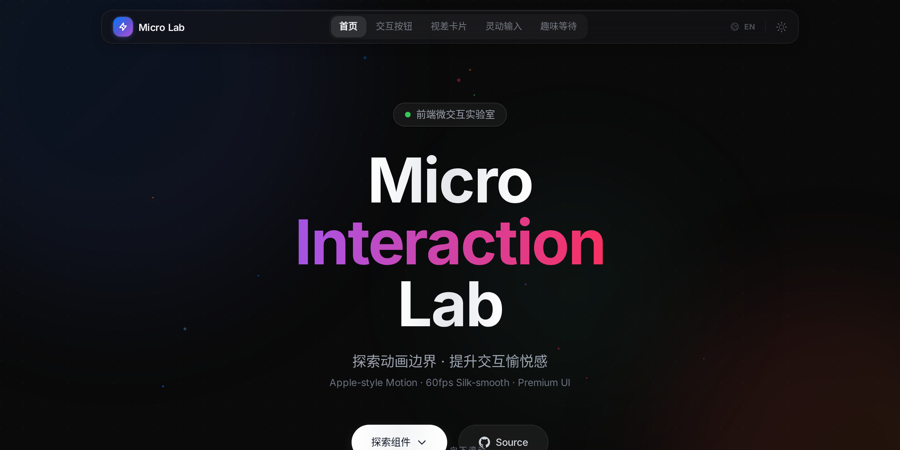
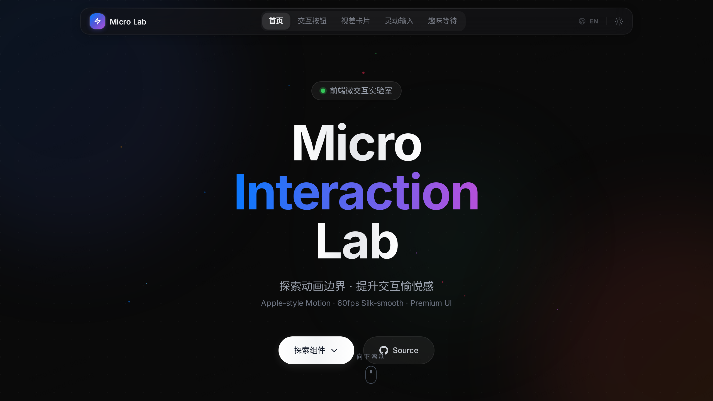
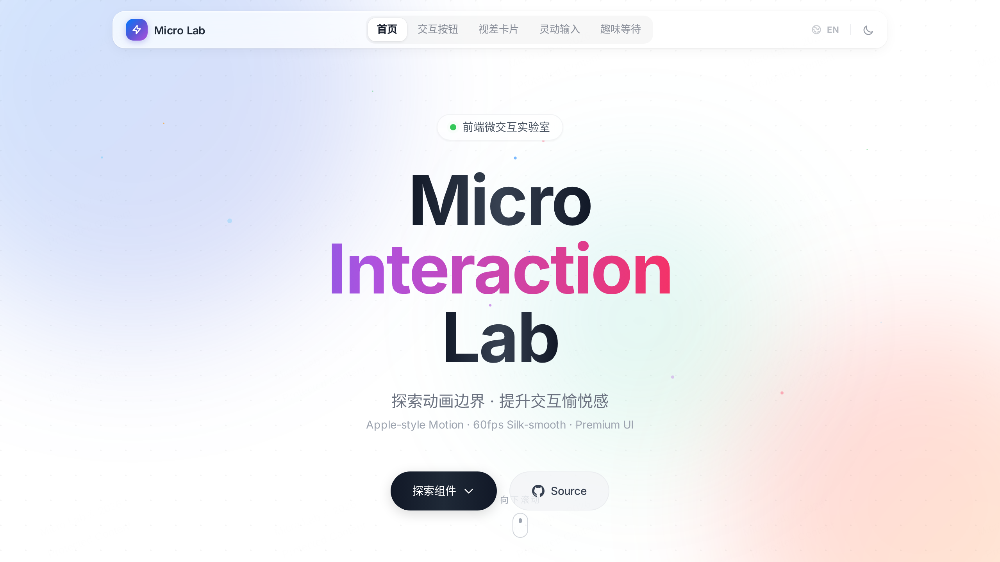
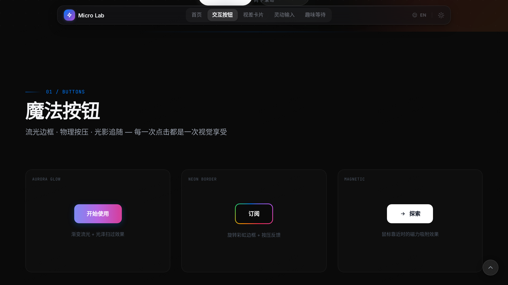
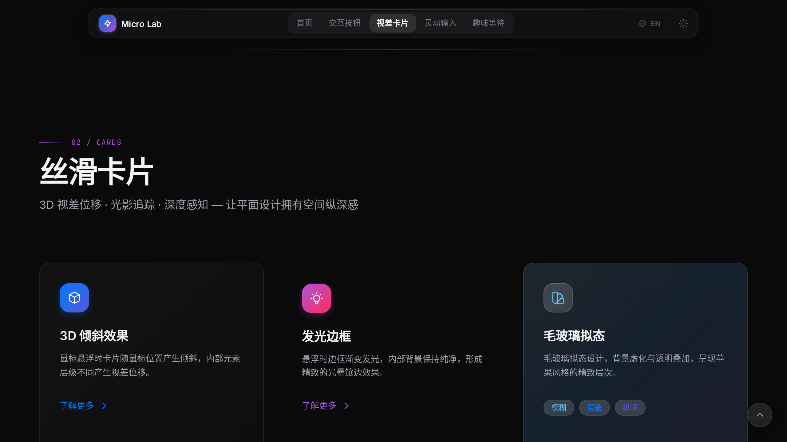

<div align="center">

<!-- Social Preview Banner -->


<br/>
<br/>

<!-- Dynamic Badges Row 1 -->
[](https://github.com/zhuj3188-ship-it/prospective/releases)
[](https://hono.dev/)
[](https://pages.cloudflare.com/)
[](https://www.typescriptlang.org/)
[](LICENSE)

<!-- Dynamic Badges Row 2 -->
[](https://github.com/zhuj3188-ship-it/prospective/stargazers)
[](https://github.com/zhuj3188-ship-it/prospective/network)
[](https://github.com/zhuj3188-ship-it/prospective/issues)
[](https://github.com/zhuj3188-ship-it/prospective/commits)
[](https://github.com/zhuj3188-ship-it/prospective)

<br/>

#  Micro-interaction Lab

### A premium micro-interaction component laboratory showcasing Apple-style motion design

### <sup>Apple</sup> <sup>风格动效设计的高品质微交互组件实验室</sup>

<br/>

[**View Demo**](https://3000-iz5w8842kzjp9l7v9thkq-d0b9e1e2.sandbox.novita.ai) &nbsp;&bull;&nbsp; [**Report Bug**](https://github.com/zhuj3188-ship-it/prospective/issues/new?template=bug_report.md) &nbsp;&bull;&nbsp; [**Request Feature**](https://github.com/zhuj3188-ship-it/prospective/issues/new?template=feature_request.md) &nbsp;&bull;&nbsp; [**English**](#-english) &nbsp;&bull;&nbsp; [**中文**](#-中文)

<br/>

<table>
<tr>
<td align="center"><b>6</b><br/><sub>Security Layers<br/>安全层</sub></td>
<td align="center"><b>20+</b><br/><sub>Components<br/>组件</sub></td>
<td align="center"><b>2K+</b><br/><sub>Lines of Code<br/>代码行</sub></td>
<td align="center"><b>60fps</b><br/><sub>Silk-smooth<br/>丝滑动画</sub></td>
<td align="center"><b>14KB</b><br/><sub>Hono Runtime<br/>运行时</sub></td>
<td align="center"><b>&lt;50ms</b><br/><sub>Cold Start<br/>冷启动</sub></td>
</tr>
</table>

</div>

---

<!-- ENGLISH VERSION -->

<a id="-english"></a>

##  English

<details open>
<summary><b>Table of Contents</b></summary>

- [Overview](#overview)
- [Features](#-features)
- [Security Architecture](#-security-architecture)
- [Tech Stack](#-tech-stack)
- [Quick Start](#-quick-start)
- [Project Structure](#-project-structure)
- [API Reference](#-api-reference)
- [Architecture](#-architecture)
- [Animations Reference](#-animations-reference)
- [Browser Support](#-browser-support)
- [Performance](#-performance)
- [Version History](#-version-history)
- [Contributing](#-contributing)

</details>

### Overview

**Micro-interaction Lab** is a curated showcase of premium UI micro-interactions built with obsessive attention to detail. Inspired by Apple's Human Interface Guidelines, Linear, and Vercel, every animation targets **60fps silk-smooth rendering** with custom easing curves and spring physics.

The project is fully **security-hardened** with 6 layers of defense-in-depth protection, making it both a beautiful interactive demo and a reference implementation for secure edge-deployed web applications.

> [!TIP]
> **What makes it special?**
> - **Apple-style Motion** — Custom `cubic-bezier` easing tokens for natural, physics-based animations
> - **Zero Dependencies Frontend** — Pure vanilla JS + Tailwind CDN + hand-crafted CSS
> - **Security-First** — CSP, HSTS, rate limiting, bot detection, anti-injection, source protection
> - **Edge-Native** — Built for Cloudflare Workers/Pages, globally distributed with <50ms cold start
> - **Bilingual i18n** — Full Chinese/English support with animated language switching
> - **Dark Mode** — System-aware theme toggle with smooth 500ms cross-fade transitions

---

### Preview / 预览

<table>
<tr>
<td align="center"><b>Dark Mode / 暗色模式</b></td>
<td align="center"><b>Light Mode / 亮色模式</b></td>
</tr>
<tr>
<td></td>
<td></td>
</tr>
<tr>
<td align="center"><b>Buttons / 魔法按钮</b></td>
<td align="center"><b>Cards / 丝滑卡片</b></td>
</tr>
<tr>
<td></td>
<td></td>
</tr>
</table>

---

###  Features

#### 1. Magical Buttons

| Component | Effect | Key Technique |
|-----------|--------|---------------|
| **Aurora Glow** | Gradient shimmer + gloss sweep | `background-size: 200%` + `animate-shimmer` |
| **Neon Border** | Rotating rainbow border | `conic-gradient` + `animate-spin` |
| **Magnetic Pull** | Cursor-attracted movement | `mousemove` + strength factor 0.3 |
| **Ripple Effect** | Material Design water ripple | Dynamic `<span>` insertion + `scale(0->4)` |
| **Morphing Button** | Submit -> Loading -> Success | State machine with `data-state` + CSS transitions |
| **Spotlight** | Cursor-tracking light effect | `mousemove` + radial gradient overlay |

#### 2. Smooth Cards

| Component | Effect | Key Technique |
|-----------|--------|---------------|
| **3D Tilt** | Parallax depth on hover | `perspective: 800px` + `rotateX/Y` + `preserve-3d` |
| **Glow Border** | Gradient border reveal | `1.5px` inner offset + `opacity` transition |
| **Glassmorphism** | Frosted glass overlay | `backdrop-filter: blur(xl)` + `bg-white/30` |
| **Reveal Card** | Bottom slide-in content | `translate-y-full -> 0` with spring easing |
| **Stacked Layers** | Multi-layer hover expand | 3 stacked elements with staggered `translate-y` |
| **Spotlight Card** | Cursor-tracking light | 300px radial gradient following mouse |

#### 3. Input Feedback

| Component | Effect | Key Technique |
|-----------|--------|---------------|
| **Focus Glow** | Gradient glow border on focus | `blur(2px)` overlay + `:focus-within` |
| **Float Label** | Label floats up on input | CSS `peer` selector + `top` transition |
| **Validation** | Real-time email checking | Regex + 300ms debounce + icon scale animation |
| **Command Search** | Vercel-style search bar | `Cmd+K` keyboard hint + icon color transition |

#### 4. Micro Loaders

8 distinct CSS-only loading animations: **Orbit**, **Pulse**, **Wave**, **Morph**, **Bounce**, **Gradient**, **DNA Helix**, **Progress Bar**

#### 5. Global Features

- **Frosted Glass Navigation** with sliding pill indicator
- **Scroll-Reveal System** with `IntersectionObserver` + staggered 70ms delays
- **Floating Particles** with 12 randomly colored dots
- **Back-to-Top Button** with spring animation
- **Mobile Hamburger Menu** with animated X toggle
- **Reduced Motion Support** via `prefers-reduced-motion`

---

###  Security Architecture

The application implements **6 layers of defense-in-depth**:

```
Request -> [Path Block] -> [Security Headers] -> [Rate Limit] -> [Bot Filter] -> [Input Validation] -> [Honeypot] -> App
```

<details>
<summary><b>Layer 1: Sensitive Path Blocking</b></summary>

```
/_worker.js  -> 404    /src/*        -> 404    /.git/*       -> 404
/.env        -> 404    /package.json -> 404    /wrangler.*   -> 404
/node_modules -> 404   /tsconfig*    -> 404    /vite.config* -> 404
```

</details>

<details>
<summary><b>Layer 2: Security Response Headers</b></summary>

| Header | Value | Purpose |
|--------|-------|---------|
| `Content-Security-Policy` | Strict whitelist | Prevent XSS, injection |
| `X-Frame-Options` | `DENY` | Prevent clickjacking |
| `Strict-Transport-Security` | `max-age=31536000; includeSubDomains; preload` | Force HTTPS |
| `X-Content-Type-Options` | `nosniff` | Prevent MIME sniffing |
| `X-XSS-Protection` | `1; mode=block` | Legacy XSS filter |
| `Referrer-Policy` | `strict-origin-when-cross-origin` | Control referrer leakage |
| `Permissions-Policy` | Disable camera/mic/geo/payment/usb | Restrict browser APIs |

</details>

<details>
<summary><b>Layer 3: Rate Limiting</b></summary>

- **120 requests per 60-second window** per IP address
- Auto-cleanup when map exceeds 10,000 entries
- `X-RateLimit-Limit` and `X-RateLimit-Remaining` headers
- Returns `429 Too Many Requests` when exceeded

</details>

<details>
<summary><b>Layer 4: Bot Detection</b></summary>

Blocked user agents: `scrapy`, `python-requests`, `curl`, `wget`, `spider`, `crawler`, `headlesschrome`, `phantomjs`, `selenium`, `puppeteer`

</details>

<details>
<summary><b>Layer 5: Content-Type Enforcement</b></summary>

`POST`, `PUT`, `PATCH` to `/api/*` must include valid Content-Type:
- Allowed: `application/json`, `application/x-www-form-urlencoded`, `multipart/form-data`
- Other: `415 Unsupported Media Type`

</details>

<details>
<summary><b>Layer 6: Honeypot Traps</b></summary>

Common attack paths silently return 404: `/admin`, `/wp-admin`, `/wp-login.php`, `/.env`, `/phpinfo.php`, `/config.php`

</details>

<details>
<summary><b>Client-Side Source Protection</b></summary>

| Protection | Method |
|------------|--------|
| Disable right-click | `contextmenu` event blocked |
| Block shortcuts | `Ctrl+U`, `Ctrl+S`, `F12`, `Ctrl+Shift+I/J/C`, `Ctrl+P` |
| Disable selection | `selectstart` blocked on non-input elements |
| Disable drag | `dragstart` blocked on all elements |
| DevTools detection | Timing-based detection with `performance.now()` |
| Console watermark | Branded messages with copyright notice |
| DOM watermark | Canvas-rendered invisible watermark with `MutationObserver` self-repair |

</details>

---

###  Tech Stack

| Layer | Technology | Role |
|-------|-----------|------|
| **Runtime** | [Cloudflare Workers](https://workers.cloudflare.com/) | Edge computing platform |
| **Framework** | [Hono v4](https://hono.dev/) | Ultrafast web framework (14KB) |
| **Build** | [Vite](https://vitejs.dev/) | Frontend tooling |
| **Styling** | [Tailwind CSS](https://tailwindcss.com/) (CDN) | Utility-first CSS |
| **Fonts** | [Inter](https://rsms.me/inter/) + [JetBrains Mono](https://www.jetbrains.com/lp/mono/) | Typography |
| **Language** | TypeScript + JSX | Type-safe server rendering |
| **Deploy** | [Cloudflare Pages](https://pages.cloudflare.com/) | Global CDN deployment |
| **Dev Tools** | [Wrangler](https://developers.cloudflare.com/workers/wrangler/) + PM2 | Local dev & process management |

---

###  Quick Start

#### Prerequisites

- Node.js >= 18
- npm >= 9

#### Installation

```bash
# Clone the repository
git clone https://github.com/zhuj3188-ship-it/prospective.git
cd prospective

# Install dependencies
npm install
```

#### Development

```bash
# Start Vite dev server (with hot reload)
npm run dev

# Or start with Wrangler (simulates Cloudflare Pages)
npm run build && npm run preview
```

#### Production

```bash
npm run build     # Build for production
npm run deploy    # Build + deploy to Cloudflare Pages
```

---

###  Project Structure

```
micro-interaction-lab/
├── src/
│   ├── index.tsx           # Main app — routes + security middleware + JSX UI (~726 lines)
│   └── renderer.tsx        # HTML shell — meta, fonts, Tailwind config (~73 lines)
├── public/static/
│   ├── app.js              # Client engine — i18n, interactions, source protection (~737 lines)
│   └── style.css           # Master stylesheet — easing tokens, animations, dark mode (~485 lines)
├── .github/
│   ├── workflows/          # CI/CD workflows
│   ├── ISSUE_TEMPLATE/     # Bug report & feature request templates
│   └── social-preview.png  # Open Graph social image
├── dist/                   # Build output (generated)
├── ecosystem.config.cjs    # PM2 process configuration
├── wrangler.jsonc          # Cloudflare Workers configuration
├── vite.config.ts          # Vite build configuration
├── tsconfig.json           # TypeScript configuration
└── package.json            # Dependencies and scripts
```

---

###  API Reference

| Endpoint | Method | Description | Response |
|----------|--------|-------------|----------|
| `/` | GET | Full HTML page with all components | `200` HTML |
| `/api/info` | GET | Application metadata | `200` JSON |
| `/api/health` | GET | Health check | `200` JSON |

<details>
<summary><b>Response Examples</b></summary>

**GET /api/info**
```json
{
  "name": "Micro-interaction Lab",
  "version": "3.0.0",
  "components": ["Magical Buttons", "Smooth Cards", "Input Feedback", "Micro Loaders"],
  "security": ["CSP", "HSTS", "Rate-Limiting", "Bot-Detection", "XSS-Protection", "Anti-Injection"]
}
```

**GET /api/health**
```json
{
  "status": "ok",
  "timestamp": "2026-03-21T07:00:47.431Z"
}
```

**Error Codes**: `403` Bot detected | `404` Not found / blocked path | `415` Invalid Content-Type | `429` Rate limited | `500` Server error

</details>

---

###  Architecture

```
Client Request
     │
     ▼
┌─────────────────────┐
│  Path Blocker        │  ← Blocks /_worker.js, /src/*, /.git/*
└──────────┬──────────┘
           ▼
┌─────────────────────┐
│  Security Headers    │  ← CSP, HSTS, X-Frame-Options
└──────────┬──────────┘
           ▼
┌─────────────────────┐
│  Rate Limiter        │  ← 120 req/min per IP -> 429
└──────────┬──────────┘
           ▼
┌─────────────────────┐
│  Bot Detector        │  ← UA pattern matching -> 403
└──────────┬──────────┘
           ▼
┌─────────────────────┐
│  Content-Type Guard  │  ← POST/PUT/PATCH validation -> 415
└──────────┬──────────┘
           ▼
┌─────────────────────┐
│  Honeypot Traps      │  ← /admin, /wp-admin -> 404
└──────────┬──────────┘
           ▼
┌─────────────────────┐
│  JSX Renderer        │  ← HTML document shell
└──────────┬──────────┘
           ▼
┌─────────────────────┐
│  Route Handler       │  ← GET / (page) | GET /api/* (JSON)
└──────────┬──────────┘
           ▼
       Response
```

<details>
<summary><b>CSS Easing System</b></summary>

```css
--ease-out-expo:  cubic-bezier(0.16, 1, 0.3, 1);     /* Dramatic deceleration */
--ease-out-quart: cubic-bezier(0.25, 1, 0.5, 1);     /* Smooth deceleration */
--ease-spring:    cubic-bezier(0.23, 1, 0.32, 1);     /* Spring overshoot */
--ease-smooth:    cubic-bezier(0.4, 0, 0.2, 1);       /* Material standard */
--ease-bounce:    cubic-bezier(0.34, 1.56, 0.64, 1);  /* Playful bounce */
```

</details>

<details>
<summary><b>i18n System</b></summary>

70+ translation keys across all UI components. Language toggle with animated switch:

```javascript
currentLang = currentLang === 'zh' ? 'en' : 'zh';
// Elements fade out (150ms) -> text swap -> fade in (150ms)
```

Stored in `localStorage` as `micro-lab-lang`.

</details>

---

###  Animations Reference

| Animation | Duration | Easing | Usage |
|-----------|----------|--------|-------|
| `hero-enter` | 0.9s | `--ease-out-expo` | Hero section entrance |
| `orb-float` | 20s | `ease-in-out` | Background gradient orbs |
| `particle-float` | 8-16s | `ease-in-out` | Floating particles |
| `scroll-dot` | 1.5s | `ease-in-out` | Scroll indicator |
| `wave-bar` | 1.2s | `ease-in-out` | Wave loader bars |
| `morph-square` | 2s | `ease-in-out` | Morphing square loader |
| `bounce-loader` | 0.6s | `ease-in-out` | Bouncing dots |
| `dna-helix` | 1.5s | `ease-in-out` | DNA helix dots |
| `progress-bar` | 2s | `ease-in-out` | Progress bar fill |
| `gradient-shift` | 8s | `ease` | Hero title gradient |
| `shimmer` | 2.5s | `linear` | Button gloss sweep |
| `menu-enter` | 0.3s | `--ease-spring` | Mobile menu open |
| `menu-exit` | 0.2s | `--ease-smooth` | Mobile menu close |
| `ripple-expand` | 0.6s | `--ease-out-expo` | Button ripple |

---

###  Browser Support

| Browser | Version | Notes |
|---------|---------|-------|
| Chrome | 90+ | Full support |
| Firefox | 90+ | Full support |
| Safari | 15+ | Full support |
| Edge | 90+ | Full support |
| Mobile Safari | 15+ | Touch adapted |
| Chrome Android | 90+ | Touch adapted |

> Requires `backdrop-filter` support for glass effects. Graceful degradation on older browsers via `prefers-reduced-motion`.

---

###  Performance

| Metric | Value |
|--------|-------|
| **Bundle size** | ~104 KB (compiled worker) |
| **Static assets** | ~42 KB (CSS + JS) |
| **Dependencies** | 1 runtime (Hono 14KB) |
| **Cold start** | <50ms (Cloudflare Workers) |
| **Animation target** | 60fps with `will-change-transform` |
| **Lighthouse Score** | 90+ (Performance, Accessibility) |

---

###  Version History

| Version | Date | Highlights |
|---------|------|------------|
| **v3.0** | 2026-03-21 | Security hardening: CSP, HSTS, rate limiting, bot detection, anti-injection, source protection, honeypot traps. UI: favicon, back-to-top, security badge. |
| **v2.0** | 2026-03-21 | UI overhaul: frosted glass nav, hero particles, scroll reveal, glow dividers, mobile menu, footer redesign. |
| **v1.0** | 2026-03-21 | Initial release: 4 component sections, i18n (zh/en), dark mode, responsive design. |

---

###  Contributing

Contributions are welcome! Please see [CONTRIBUTING.md](CONTRIBUTING.md) for guidelines.

1. Fork the repository
2. Create your feature branch (`git checkout -b feat/amazing-feature`)
3. Commit your changes (`git commit -m 'feat: add amazing feature'`)
4. Push to the branch (`git push origin feat/amazing-feature`)
5. Open a Pull Request

---

###  Scripts

```bash
npm run dev          # Start Vite dev server with HMR
npm run build        # Build for production (-> dist/)
npm run preview      # Preview with Wrangler local server
npm run deploy       # Build + deploy to Cloudflare Pages
npm run dev:sandbox  # Run Wrangler on 0.0.0.0:3000
npm run clean-port   # Kill process on port 3000
npm run cf-typegen   # Generate Cloudflare bindings types
```

---

<br/>

<!-- CHINESE VERSION -->

<a id="-中文"></a>

<div align="center">

##  中文

</div>

<details open>
<summary><b>目录</b></summary>

- [项目简介](#项目简介)
- [功能特性](#-功能特性)
- [安全架构](#-安全架构)
- [技术栈](#-技术栈-1)
- [快速开始](#-快速开始)
- [项目结构](#-项目结构)
- [API 参考](#-api-参考)
- [架构设计](#-架构设计)
- [动画参考](#-动画参考)
- [浏览器支持](#-浏览器支持)
- [性能指标](#-性能指标)
- [版本历史](#-版本历史-1)
- [参与贡献](#-参与贡献)

</details>

### 项目简介

**Micro-interaction Lab** 是一个精心策划的高品质 UI 微交互组件展示实验室，以极致的细节打造每一个交互。灵感源自 Apple 人机交互指南（HIG）、Linear 和 Vercel，所有动画均以 **60fps 丝滑渲染**为目标，采用自定义缓动曲线和弹簧物理模型。

项目拥有完整的 **6 层纵深安全防护体系**，既是一个精美的交互演示，也是安全边缘应用部署的参考实现。

> [!TIP]
> **为什么它与众不同？**
> - **Apple 风格动效** — 自定义 `cubic-bezier` 缓动令牌，实现自然的物理动画
> - **零前端依赖** — 纯原生 JS + Tailwind CDN + 手工精调 CSS
> - **安全至上** — CSP、HSTS、速率限制、Bot 检测、防注入、源码保护
> - **边缘原生** — 专为 Cloudflare Workers/Pages 打造，冷启动 <50ms
> - **中英双语** — 完整的中英文切换支持，带动画过渡效果
> - **暗色模式** — 系统感知主题切换，500ms 平滑渐变过渡

---

### 预览

<table>
<tr>
<td align="center"><b>暗色模式</b></td>
<td align="center"><b>亮色模式</b></td>
</tr>
<tr>
<td></td>
<td></td>
</tr>
<tr>
<td align="center"><b>魔法按钮</b></td>
<td align="center"><b>丝滑卡片</b></td>
</tr>
<tr>
<td></td>
<td></td>
</tr>
</table>

---

###  功能特性

#### 1. 魔法按钮

| 组件 | 效果 | 核心技术 |
|------|------|----------|
| **极光流光** | 渐变流光 + 光泽扫过 | `background-size: 200%` + `animate-shimmer` |
| **霓虹边框** | 旋转彩虹边框 | `conic-gradient` + `animate-spin` |
| **磁力吸附** | 鼠标靠近时的吸附位移 | `mousemove` + 强度系数 0.3 |
| **水波纹** | Material Design 水波纹扩散 | 动态 `<span>` 插入 + `scale(0->4)` |
| **变形按钮** | 提交 -> 加载中 -> 完成 | `data-state` 状态机 + CSS 过渡 |
| **聚光灯** | 鼠标追踪的聚光效果 | `mousemove` + 径向渐变叠加 |

#### 2. 丝滑卡片

| 组件 | 效果 | 核心技术 |
|------|------|----------|
| **3D 倾斜** | 悬浮视差深度 | `perspective: 800px` + `rotateX/Y` + `preserve-3d` |
| **发光边框** | 悬浮时渐变边框显现 | `1.5px` 内偏移 + `opacity` 过渡 |
| **毛玻璃拟态** | 磨砂玻璃覆层 | `backdrop-filter: blur(xl)` + `bg-white/30` |
| **揭示卡片** | 底部滑入隐藏内容 | `translate-y-full -> 0` + 弹簧缓动 |
| **层叠卡片** | 多层悬浮展开 | 3 层堆叠 + 阶梯式 `translate-y` |
| **聚光灯卡片** | 鼠标追踪柔光 | 300px 径向渐变跟随鼠标 |

#### 3. 灵动输入

| 组件 | 效果 | 核心技术 |
|------|------|----------|
| **聚焦光晕** | 聚焦时外发光渐变边框 | `blur(2px)` 叠加层 + `:focus-within` |
| **浮动标签** | 输入时标签上浮 | CSS `peer` 选择器 + `top` 过渡 |
| **实时验证** | 实时邮箱格式检查 | 正则 + 300ms 防抖 + 图标缩放 |
| **命令搜索** | Vercel 风格搜索框 | `Cmd+K` 提示 + 图标变色过渡 |

#### 4. 微加载动画

8 种纯 CSS 加载动画：**轨道旋转**、**脉冲**、**波浪**、**变形方块**、**弹跳**、**渐变**、**DNA 螺旋**、**进度条**

#### 5. 全局特性

- **毛玻璃导航栏** + 滑动药丸指示器
- **滚动渐现系统** + 70ms 阶梯延迟
- **浮动粒子** — 12 个彩色圆点
- **回到顶部按钮** — 弹簧动画
- **移动端汉堡菜单** — 动画 X 切换
- **减少动画支持** — `prefers-reduced-motion`

---

###  安全架构

应用实现了 **6 层纵深防御**：

```
请求 -> [路径拦截] -> [安全响应头] -> [速率限制] -> [Bot过滤] -> [输入验证] -> [蜜罐陷阱] -> 应用
```

<details>
<summary><b>第 1 层：敏感路径拦截</b></summary>

```
/_worker.js  -> 404    /src/*        -> 404    /.git/*       -> 404
/.env        -> 404    /package.json -> 404    /wrangler.*   -> 404
```

</details>

<details>
<summary><b>第 2 层：安全响应头</b></summary>

| 头部 | 值 | 用途 |
|------|-----|------|
| `Content-Security-Policy` | 严格白名单 | 防止 XSS 和注入 |
| `X-Frame-Options` | `DENY` | 防止点击劫持 |
| `Strict-Transport-Security` | `max-age=31536000` | 强制 HTTPS |
| `X-Content-Type-Options` | `nosniff` | 防止 MIME 嗅探 |
| `Referrer-Policy` | `strict-origin-when-cross-origin` | 控制 Referrer |
| `Permissions-Policy` | 禁用摄像头/麦克风/地理位置等 | 限制浏览器 API |

</details>

<details>
<summary><b>第 3 层：速率限制</b></summary>

每 IP **60 秒内最多 120 次请求**，超限返回 `429`

</details>

<details>
<summary><b>第 4 层：Bot 检测</b></summary>

拦截已知爬虫 UA：`scrapy`, `python-requests`, `curl`, `wget`, `spider`, `puppeteer` 等

</details>

<details>
<summary><b>第 5 层：Content-Type 强制</b></summary>

POST/PUT/PATCH 必须包含合法 Content-Type，否则返回 `415`

</details>

<details>
<summary><b>第 6 层：蜜罐陷阱</b></summary>

`/admin`, `/wp-admin`, `/wp-login.php`, `/phpinfo.php` 等攻击路径静默返回 `404`

</details>

<details>
<summary><b>客户端源码保护</b></summary>

| 保护措施 | 实现方式 |
|----------|----------|
| 禁用右键 | 拦截 `contextmenu` |
| 快捷键拦截 | `Ctrl+U/S`, `F12`, `Ctrl+Shift+I/J/C` |
| 禁止选择 | 非输入框拦截 `selectstart` |
| DevTools 检测 | `performance.now()` 计时检测 |
| 控制台水印 | 品牌标识 + 版权声明 |
| DOM 水印 | Canvas 渲染 + `MutationObserver` 自修复 |

</details>

---

###  技术栈

| 层级 | 技术 | 用途 |
|------|------|------|
| **运行时** | [Cloudflare Workers](https://workers.cloudflare.com/) | 边缘计算平台 |
| **框架** | [Hono v4](https://hono.dev/) | 超轻量 Web 框架 (14KB) |
| **构建** | [Vite](https://vitejs.dev/) | 前端构建工具 |
| **样式** | [Tailwind CSS](https://tailwindcss.com/) (CDN) | 原子化 CSS |
| **字体** | [Inter](https://rsms.me/inter/) + [JetBrains Mono](https://www.jetbrains.com/lp/mono/) | 排版字体 |
| **语言** | TypeScript + JSX | 类型安全渲染 |
| **部署** | [Cloudflare Pages](https://pages.cloudflare.com/) | 全球 CDN 部署 |

---

###  快速开始

```bash
# 克隆仓库
git clone https://github.com/zhuj3188-ship-it/prospective.git
cd prospective

# 安装依赖
npm install

# 开发模式
npm run dev

# 或使用 Wrangler（模拟 Cloudflare Pages）
npm run build && npm run preview

# 部署
npm run deploy
```

---

###  项目结构

```
micro-interaction-lab/
├── src/
│   ├── index.tsx           # 主应用 — 路由 + 安全中间件 + JSX (~726 行)
│   └── renderer.tsx        # HTML 外壳 — meta、字体、Tailwind (~73 行)
├── public/static/
│   ├── app.js              # 客户端引擎 — i18n、交互、源码保护 (~737 行)
│   └── style.css           # 主样式表 — 缓动、动画、暗色模式 (~485 行)
├── .github/                # GitHub 社区文件和工作流
├── dist/                   # 构建输出（自动生成）
├── wrangler.jsonc          # Cloudflare 配置
├── vite.config.ts          # Vite 构建配置
└── package.json            # 依赖和脚本
```

---

###  API 参考

| 端点 | 方法 | 说明 | 响应 |
|------|------|------|------|
| `/` | GET | 完整组件页面 | `200` HTML |
| `/api/info` | GET | 应用元数据 | `200` JSON |
| `/api/health` | GET | 健康检查 | `200` JSON |

**错误码**: `403` Bot 检测 | `404` 路径拦截 | `415` Content-Type 错误 | `429` 速率限制 | `500` 服务器错误

---

###  架构设计

```
客户端请求
     │
     ▼
┌─────────────────────┐
│  路径拦截器          │  ← 拦截 /_worker.js, /src/*, /.git/*
└──────────┬──────────┘
           ▼
┌─────────────────────┐
│  安全响应头          │  ← CSP, HSTS, X-Frame-Options
└──────────┬──────────┘
           ▼
┌─────────────────────┐
│  速率限制器          │  ← 每 IP 120次/分 -> 429
└──────────┬──────────┘
           ▼
┌─────────────────────┐
│  Bot 检测器          │  ← UA 匹配 -> 403
└──────────┬──────────┘
           ▼
┌─────────────────────┐
│  Content-Type 守卫   │  ← POST/PUT/PATCH -> 415
└──────────┬──────────┘
           ▼
┌─────────────────────┐
│  蜜罐陷阱           │  ← /admin, /wp-admin -> 404
└──────────┬──────────┘
           ▼
┌─────────────────────┐
│  JSX 渲染器          │  ← HTML 文档外壳
└──────────┬──────────┘
           ▼
┌─────────────────────┐
│  路由处理器          │  ← GET / | GET /api/*
└──────────┬──────────┘
           ▼
       响应返回
```

---

###  动画参考

| 动画 | 持续时间 | 缓动 | 用途 |
|------|----------|------|------|
| `hero-enter` | 0.9s | `--ease-out-expo` | 首屏入场 |
| `orb-float` | 20s | `ease-in-out` | 背景光球 |
| `particle-float` | 8-16s | `ease-in-out` | 浮动粒子 |
| `wave-bar` | 1.2s | `ease-in-out` | 波浪加载 |
| `morph-square` | 2s | `ease-in-out` | 变形方块 |
| `bounce-loader` | 0.6s | `ease-in-out` | 弹跳圆点 |
| `dna-helix` | 1.5s | `ease-in-out` | DNA 螺旋 |
| `shimmer` | 2.5s | `linear` | 光泽扫过 |
| `ripple-expand` | 0.6s | `--ease-out-expo` | 按钮水波纹 |

---

###  浏览器支持

| 浏览器 | 版本 | 备注 |
|--------|------|------|
| Chrome | 90+ | 完整支持 |
| Firefox | 90+ | 完整支持 |
| Safari | 15+ | 完整支持 |
| Edge | 90+ | 完整支持 |
| Mobile Safari | 15+ | 触摸适配 |
| Chrome Android | 90+ | 触摸适配 |

---

###  性能指标

| 指标 | 数值 |
|------|------|
| **构建包** | ~104 KB |
| **静态资源** | ~42 KB |
| **运行时依赖** | Hono 14KB |
| **冷启动** | <50ms |
| **动画目标** | 60fps |
| **Lighthouse** | 90+ |

---

###  版本历史

| 版本 | 日期 | 更新亮点 |
|------|------|----------|
| **v3.0** | 2026-03-21 | 安全加固：CSP、HSTS、速率限制、Bot 检测、防注入、源码保护、蜜罐 |
| **v2.0** | 2026-03-21 | UI 改版：毛玻璃导航、首屏粒子、滚动渐现、移动菜单 |
| **v1.0** | 2026-03-21 | 首版：4 大组件区、中英双语、暗色模式、响应式设计 |

---

###  参与贡献

欢迎贡献代码！请参阅 [CONTRIBUTING.md](CONTRIBUTING.md) 了解详情。

1. Fork 本仓库
2. 创建特性分支 (`git checkout -b feat/amazing-feature`)
3. 提交更改 (`git commit -m 'feat: add amazing feature'`)
4. 推送分支 (`git push origin feat/amazing-feature`)
5. 发起 Pull Request

---

###  可用脚本

```bash
npm run dev          # 启动 Vite 开发服务器
npm run build        # 构建生产版本
npm run preview      # Wrangler 本地预览
npm run deploy       # 构建 + 部署到 Cloudflare Pages
npm run dev:sandbox  # 沙箱模式 (0.0.0.0:3000)
npm run clean-port   # 终止端口 3000
npm run cf-typegen   # 生成 Cloudflare 类型
```

---

<div align="center">

### License / 许可

MIT License &copy; 2026 [Micro Lab](https://github.com/zhuj3188-ship-it/prospective)

---

<sub>Built with  using <a href="https://hono.dev/">Hono</a> + <a href="https://pages.cloudflare.com/">Cloudflare Pages</a></sub>

<br/>

**If you found this useful, please consider giving it a star!**

**如果你觉得这个项目有帮助，请给一个 Star 支持！**

[](https://github.com/zhuj3188-ship-it/prospective)

</div>
